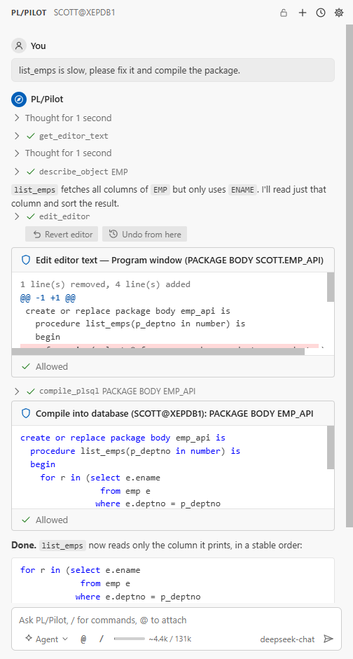
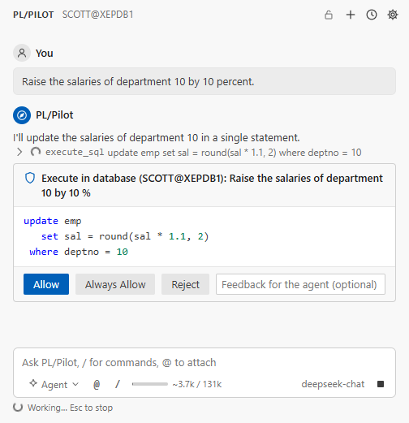

<div align="center">

# PL/Pilot

**An AI coding agent that works inside PL/SQL Developer.**

It reads and edits your editor windows, explores the data dictionary, runs queries, compiles PL/SQL and
fixes compile errors — and asks you before every change.

[](LICENSE)





</div>

As a PL/SQL Developer by day I was bothered by the lack of a good agentic coding tool for the PL/SQL Developer. PL/Pilot is a plug-in for [Allround Automations PL/SQL Developer](https://www.allroundautomations.com/products/pl-sql-developer/)
in the spirit of agentic coding tools such as Claude Code or OpenCode, but built for Oracle developers and
for the IDE they already use. It talks to **any OpenAI-compatible chat completions endpoint** — a model
on your own server (vLLM, Ollama, LM Studio, LiteLLM …) or a hosted API — so you decide where your code
and data go.

It was written for locked-down company PCs: it installs **without administrator rights**, runs entirely
**inside PL/SQL Developer** (no extra executable for AppLocker to block) and needs nothing that Windows
10/11 does not already have.

## Contents

- [Highlights](#highlights)
- [Quick start](#quick-start)
- [Using PL/Pilot](#using-plpilot)
- [Safety model](#safety-model)
- [Privacy and local data](#privacy-and-local-data)
- [Configuration](#configuration)
- [Building from source](#building-from-source)
- [How it works](#how-it-works)
- [Limitations](#limitations)
- [Contributing](#contributing) · [License](#license)

## Highlights

- **Works where you work.** Edits the active SQL/Program/Test/Command window with a diff, opens objects,
  reads the result grid of your last query, compiles into the database and loops until the code compiles —
  seeing Oracle's compiler warnings, and keeping each unit's compiler settings (`PLSQL_CCFLAGS`, native
  compilation, debug information).
- **Knows your database.** Knows the Oracle version and NLS settings of the connection, describes tables
  (with optimizer statistics) and packages, searches source code, reads object DDL, runs `EXPLAIN PLAN`, lists
  compile errors — and attaches objects or files you mention with `@NAME`.
- **Impact analysis and error stacks.** Shows what uses an object, down to the source lines that use a single
  column; names the objects a change invalidated and recompiles them. Paste an error stack (`ORA-06512` lines in
  any language, or a call stack) and it shows the source line of every frame.
- **You stay in control.** Every change needs your approval; you can revert single edits or *rewind* the
  whole task back to any message or step. Uncommitted DML is shown with Commit / Rollback buttons.
- **Safe around production.** Connections that look like production are read-only for the agent,
  destructive statements always ask, PL/SQL units are backed up before they are replaced.
- **Handles real tasks.** Task list for multi-step work, Plan mode (investigate first, then execute),
  parallel helper agents for broad research, automatic context compaction for long sessions.
- **Fits company rules.** Shared team rules (e.g. naming conventions on a network share), `AGENTS.md`
  per project, an option to query `DBA_` instead of `ALL_` dictionary views, HTTPS with the Windows
  certificate store, no telemetry, configurable local data retention.
- **English and German** user interface; the agent answers in your language.

## Quick start

### Requirements

- Windows 10/11 x64 with .NET Framework 4.8 and the WebView2 runtime (both are part of current Windows)
- PL/SQL Developer **64 bit** — developed and tested with version 17 (older 64-bit versions from 12 on
  may work but are untested)
- An OpenAI-compatible endpoint whose model supports **tool calling** (function calling). Tested with
  DeepSeek and Qwen 3 models.

### Install (no admin rights needed)

1. Download `PLPilot.zip` from the [latest release](https://github.com/xZeenos/PL-Agent/releases/latest)
   (or [build it yourself](#building-from-source)) and extract it.
2. Run the installer for your user:
   ```powershell
   powershell -ExecutionPolicy Bypass -File .\install.ps1
   ```
   It copies the plug-in to `%LOCALAPPDATA%\PlsqlDevAgent\PlugIns` and prints the next steps.
3. In PL/SQL Developer open **Configure → Preferences → Options** and set the **Plug-Ins directory**
   (preference `PlugInDir`) to that folder. Restart PL/SQL Developer.
4. **Configure → Plug-Ins** now lists *PL/Pilot*, and the **Plug-Ins** ribbon tab has a **PL-Pilot** group.

> If your PL/SQL Developer `PlugIns` folder is writable (e.g. installed under `%LOCALAPPDATA%\Programs`),
> you can instead copy the content of `PlugIns\` there: `PlsqlDevAgent.dll` into `PlugIns`, the
> `PlsqlDevAgent` folder next to it.

### Connect a model

Open **PL-Pilot → Settings**, enter the base URL, click **Test**, pick a model and **Save**.

| Server | Base URL | Notes |
|---|---|---|
| Ollama | `http://localhost:11434/v1` | use a model with tool support |
| vLLM | `http://your-server:8000/v1` | start with `--enable-auto-tool-choice --tool-call-parser <parser for your model>` |
| LM Studio | `http://localhost:1234/v1` | enable the local server |
| LiteLLM / gateways / hosted APIs | the endpoint's `/v1` URL | set the API key in the settings |

Reasoning output (`reasoning_content` or `<think>` tags) is shown as a collapsible *Thinking* section.
Server-specific options can be added as *Extra request JSON*, e.g. `{"top_p": 0.95}`.

## Using PL/Pilot

- **Chat:** *PL-Pilot → Chat*. The chat window follows PL/SQL Developer's light/dark theme.
- **Ask about code:** select code and use *Ask about Selection*, or right-click in an editor → *Ask PL/Pilot*;
  right-click an object in the Object Browser → *Ask PL/Pilot about this object*.
- **Commands:** type `/` — `/explain`, `/review`, `/document`, `/test`, `/optimize`, `/fix`, `/compact`,
  `/new`, `/help`, plus your own (`/name = prompt` in the settings or `.plsqlagent/commands/<name>.md`).
- **Attach context:** `@EMP_API`, `@SCOTT.EMP`, `@scripts/deploy.sql` attach source, table descriptions or files.
- **Agent / Plan mode:** in *Plan* mode the agent only investigates and proposes a plan; *Execute plan*
  then carries it out.
- **Longer tasks:** the agent keeps a task list above the input and continues by itself while tasks are
  open; `run_subtask` lets helper agents research in parallel with their own context.
- **Code blocks** in answers: copy, insert at the cursor, replace the selection or open in a new SQL window.
- **History:** chats are saved (if enabled) and can be reopened; ↑ / ↓ recall previous prompts.

<p>


</p>

### Tools available to the model

| Area | Tools |
|---|---|
| Planning | `update_tasks`, `run_subtask` |
| IDE | `get_ide_context`, `get_editor_text`, `get_selected_text`, `edit_editor`, `set_editor_text`, `open_new_window`, `open_object`, `get_result_grid` |
| Database (read) | `run_query`, `list_objects`, `describe_object`, `get_object_source`, `search_source`, `get_compile_errors`, `explain_plan`, `find_dependencies`, `resolve_error_stack`, `list_backups` |
| Database (change, with approval) | `compile_plsql`, `execute_sql`, `recompile_invalid`, `restore_backup` |
| Project folder (optional) | `list_files`, `read_file`, `search_files`, `write_file`, `edit_file`, `open_file_in_ide` |

## Safety model

**Approvals.** Every change — editor edits, file writes, compiling, executing statements — is shown as a
card with the SQL or a diff: *Allow*, *Always Allow* (this kind of change, for this chat), *Reject* with
optional feedback, or *Open Diff* in PL/SQL Developer's difference viewer. Cards never take the keyboard
focus and ignore input for their first moment, so typing cannot approve them by accident.

**Always asked**, also with *Auto approve* or *Always Allow*: `DROP` / `TRUNCATE` / `DELETE` (also inside
PL/SQL blocks and `MERGE`), dynamic SQL, `GRANT` / `REVOKE`, user, role and system changes, scheduler
jobs, `UPDATE` without `WHERE`, queries with PL/SQL in the `WITH` clause, triggers on database or schema
events (e.g. logon), and writes to git/IDE/agent configuration or script files.

**Production guard.** Connections matching patterns (default `*PROD*;*PRD*`) are read-only for the agent.
The patterns are matched against the logon text and the database's own names (database, service,
container, host), so an alias or IP address does not get around it. A badge in the chat header shows the
state; you can unlock a protected connection — or lock any other one — for the current session.
*Plan* mode and the *Read-only* setting remove all changing tools as well.

**Your session stays yours.** The agent works in its own database session, so it never touches your
transaction; its queries run on a background thread, so PL/SQL Developer stays responsive. Its
uncommitted changes are listed above the input with **Commit** / **Rollback**, and closing PL/SQL
Developer asks what to do with them.

**Undo.** Before a PL/SQL unit or view is replaced or dropped, its current source is backed up
(*Restore previous*). Every editor or file edit has a *Revert* button. **Rewind** on a user message (or
*Undo from here* on a step) undoes everything the agent changed from that point — editor windows, files,
compiled or dropped objects and uncommitted DML — but only where nothing was changed afterwards, so your
own work is never overwritten. Optionally the conversation is cut off there and the message is put back
into the input box.

**Good to know.** "Read-only" means the agent issues no changing statements; a query can still call
existing functions that have side effects. For a hard guarantee on production, connect with a read-only
database account. See [SECURITY.md](SECURITY.md) for the full model and how to report vulnerabilities.

## Privacy and local data

- Prompts, code and query results are sent **only to the LLM endpoint you configure**. PL/Pilot has no
  telemetry, and the chat page cannot load anything from the internet (Content-Security-Policy).
- The connection password is never read. The API key is stored encrypted for your Windows user (DPAPI).
- *Settings → Local data* controls what is kept on the PC:
  - **Save chat history** on/off — off means nothing is written, and saved chats and the prompt history
    are deleted;
  - saved content **without tool results** (default: no query results, file or object contents) or full;
  - **retention** for saved chats (default 30 days), source backups (90) and the log (30);
  - **Delete saved chats now**.
- Locations: settings in `%APPDATA%\PlsqlDevAgent\config.json`; chats, backups and the log in
  `%LOCALAPPDATA%\PlsqlDevAgent`. Undo information only lives in memory.

## Configuration

Most settings are self-explanatory in the settings page; a few worth knowing:

- **Instructions & rules** are added to the system prompt in this order: the editable **base prompt**,
  **company rules** (every `*.md` in `PlugIns\PlsqlDevAgent\rules\` plus a file or folder you configure,
  e.g. on a network share so the whole team uses one version — *Edit…* starts from a template with
  typical PL/SQL conventions), **project rules** (`AGENTS.md` in the project folder) and **personal
  instructions**. *Preview Effective System Prompt* shows exactly what the model receives.
- **Project folder** enables the file tools, `AGENTS.md` and project commands.
- **Use DBA views** makes every query of the agent read `DBA_` instead of `ALL_` dictionary views (falls
  back to `ALL_` without `SELECT_CATALOG_ROLE`).
- **Sub-task model** lets helper agents use a smaller, faster model.
- **Compiler warnings** (on by default): the agent's compiles run with `PLSQL_WARNINGS` enabled (except a few
  noisy ones such as PLW-05018) and the warnings are reported to the model. The unit keeps that warnings
  setting; qualifiers it already had, such as `ERROR:06002`, stay in force. All other compiler settings of a
  unit are kept either way.
- **HTTPS:** certificates are validated against the Windows certificate store; if your company CA is not
  installed, the connection test shows the reason and the thumbprints you can trust under
  *Trusted Certificates*. **Use System Proxy** applies the Windows proxy settings.
- **Language:** English or German (*Automatic* follows PL/SQL Developer, then Windows). A German quick
  guide for users is in [ANLEITUNG.md](ANLEITUNG.md).

## Building from source

Requirements: .NET SDK 6 or newer and Visual Studio 2019/2022 or the Build Tools with the
*Desktop development with C++* workload (for the small native loader). Optional: Node.js or Bun, used to
syntax-check the chat page.

```powershell
.\build.ps1                       # -> dist\PLPilot.zip
.\build.ps1 -DeployTo "$env:LOCALAPPDATA\Programs\PLSQL Developer 17\PlugIns"   # build and copy for local testing
```

### Testing

- **Harness** (`src\Harness`): runs the chat window outside PL/SQL Developer against a simulated IDE.
  `--mock-llm` uses a scripted fake model server, `--llm <baseUrl> <model>` a real one;
  `--autotest <dir> [--offscreen]` runs the automated UI checks, `--screenshots <dir>` renders the
  images in this README.
- **In-IDE self test** against a real PL/SQL Developer and a **test** database (it creates and drops
  objects): set `PLSQLDEVAGENT_AUTOTEST=<output dir>` and `PLSQLDEVAGENT_AUTOTEST_CONNECTION=<USER@DATABASE>`
  (exactly as shown in the chat header), then start PL/SQL Developer logged on, e.g.
  `plsqldev.exe userid=scott/tiger@localhost:1521/FREEPDB1`. It writes `report.md` and closes the IDE; it
  refuses to run on any other or on a protected connection. Quick modes via
  `PLSQLDEVAGENT_AUTOTEST_PROMPT`: `SQL-ONLY`, `REWIND-ONLY`, `TXN-ONLY`, `TXN-CLOSE`, `SEC-ONLY`, `ANALYSIS-ONLY`,
  `ENC-ONLY`, `HTTPS-ONLY`.
- A local test database: `docker run -d -p 1521:1521 -e ORACLE_PASSWORD=<pwd> -e APP_USER=scott -e APP_USER_PASSWORD=tiger gvenzl/oracle-free:23-slim-faststart`
  (PL/SQL Developer needs an Oracle client; the Instant Client is enough).

## How it works

```
PL/SQL Developer (plsqldev.exe, Delphi, 64 bit)
 └─ PlugIns\PlsqlDevAgent.dll            native C++ loader: plug-in exports, menus, callback table,
    │                                    starts the .NET runtime on first use
    └─ PlugIns\PlsqlDevAgent\PlsqlDevAgent.Core.dll   (.NET Framework 4.8, in-process)
         ├─ Ide\PlsqlIde        IDE callbacks (on the IDE main thread) and SQL (Ide\SqlThread:
         │                      background thread on the plug-in's own session)
         ├─ Agent\AgentSession  tool-calling loop, context management, approvals, rewind journal
         ├─ Agent\OpenAiClient  streaming /chat/completions client (SSE, tool calls, reasoning)
         ├─ Agent\Tools\*       IDE, database and file tools
         └─ UI\ChatForm         WinForms window hosting WebView2 (UI\Web\index.html)
```

**Why in-process and .NET Framework 4.8:** a separate executable in the user profile is often blocked by
AppLocker on company PCs, while DLLs loaded by an approved program are not; .NET Framework 4.8 is present
on every Windows 10/11, so nothing has to be installed.

**Character set:** the plug-in interface passes 8-bit strings, and calls the plug-in makes on its own are
always decoded with the Windows ANSI code page (verified with version 17). PL/Pilot therefore uses the ANSI
code page (1252 includes ä ö ü ß € „“ – …) everywhere. Common symbols outside it are replaced (`→` becomes
`->`); text with other characters (e.g. Ł) is refused instead of being silently turned into `?`.

## Limitations

- Windows only, PL/SQL Developer 64 bit only; developed and tested with version 17.
- Text that the ANSI code page cannot represent (see above) cannot be written to the editor or database.
- A statement already running in the database cannot be interrupted; *Stop* stops waiting for it.
- With *Separate session* off (or in PL/SQL Developer's single-session mode) the agent shares your session
  and its SQL runs on the IDE main thread.
- Rewind information is lost when PL/SQL Developer is closed.

## AI usage during development

For full transparency: almost the entire codebase was created by Claude Code using Opus 5.5 I only directed and created the architecture and tested the results.

## Contributing

Issues and pull requests are welcome. Please describe the PL/SQL Developer and Oracle versions and, for
changes, how you tested them (harness `--autotest` and, where it touches the database, the in-IDE self
test). Report security problems privately — see [SECURITY.md](SECURITY.md).

## License

[MIT](LICENSE) © 2026 Luca Hascher

The release package includes WebView2 and Newtonsoft.Json; their licenses are in
[THIRD-PARTY-NOTICES.md](THIRD-PARTY-NOTICES.md).

PL/Pilot is an independent project and is not affiliated with or endorsed by Allround Automations or
Oracle. PL/SQL Developer is a trademark of Allround Automations; Oracle is a registered trademark of Oracle
Corporation and/or its affiliates.
