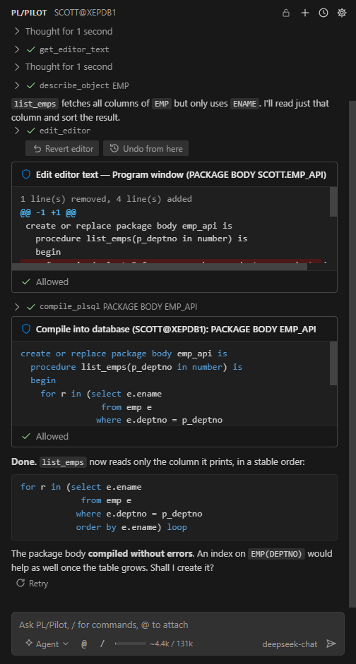
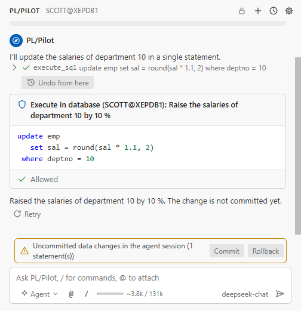

<div align="center">

# PL/Pilot

**An AI coding agent that works inside PL/SQL Developer.**

It reads and edits your editor windows, explores the data dictionary, runs queries, compiles PL/SQL and
fixes compile errors — and asks you before every change.

[](LICENSE)




</div>

As a PL/SQL Developer by day I was bothered by the lack of a good agentic coding tool for the PL/SQL Developer. PL/Pilot is a plug-in for [Allround Automations PL/SQL Developer](https://www.allroundautomations.com/products/pl-sql-developer/)
in the spirit of agentic coding tools such as Claude Code or OpenCode, but built for Oracle developers and
for the IDE they already use. It talks to **any OpenAI-compatible chat completions endpoint** — a model
on your own server (vLLM, Ollama, LM Studio, LiteLLM …) or a hosted API — so you decide where your code
and data go.

It was written for locked-down company PCs: it installs **without administrator rights**, runs entirely
**inside PL/SQL Developer** (no extra executable for AppLocker to block) and needs nothing that Windows
10/11 does not already have.

## Contents

- [Highlights](#highlights)
- [Quick start](#quick-start)
- [Using PL/Pilot](#using-plpilot)
- [Safety model](#safety-model)
- [Privacy and local data](#privacy-and-local-data)
- [Configuration](#configuration)
- [Building from source](#building-from-source)
- [How it works](#how-it-works)
- [Limitations](#limitations)
- [Contributing](#contributing) · [License](#license)

## Highlights

- **Works where you work.** Edits the active SQL/Program/Test/Command window with a diff, opens objects,
  reads the result grid of your last query, compiles into the database and loops until the code compiles —
  seeing Oracle's compiler warnings, and keeping each unit's compiler settings (`PLSQL_CCFLAGS`, native
  compilation, debug information).
- **Knows your database.** Knows the Oracle version and NLS settings of the connection, describes tables
  (with optimizer statistics) and packages, searches source code, reads object DDL, runs `EXPLAIN PLAN`, lists
  compile errors — and attaches objects or files you mention with `@NAME`.
- **Gets the picture in one step.** `explore_objects` returns a dossier of several objects at once: their full
  source or structure, the tables and packages they use, the code that calls or writes them (with the lines) and
  the foreign-key neighbours. With a large context window this replaces a dozen slow look-up round trips.
- **Impact analysis and error stacks.** Shows what uses an object, down to the source lines that use a single
  column; names the objects a change invalidated and recompiles them. Paste an error stack (`ORA-06512` lines in
  any language, or a call stack) and it shows the source line of every frame.
- **Measures instead of guessing.** Runs a statement and shows the actual plan (estimated vs actual rows per
  step) with its real costs, and proves a rewrite: same rows, numbers before and after. Writes utPLSQL tests,
  runs them and reports failures and code coverage (without utPLSQL: a test block in a Test window).
- **You stay in control.** Every change needs your approval; you can revert single edits or *rewind* the
  whole task back to any message or step. Uncommitted DML is shown with Commit / Rollback buttons.
- **Safe around production.** Connections that look like production are read-only for the agent,
  destructive statements always ask, PL/SQL units are backed up before they are replaced.
- **Handles real tasks.** Task list for multi-step work, Plan mode (investigate first, then execute),
  parallel helper agents for broad research, automatic context compaction for long sessions.
- **Reaches your other systems.** Connect MCP servers over HTTP — e.g. the ticket system or version
  control — and the agent reads the ticket and the commit history before it goes into the packages. Tools
  that change something there ask first, like every other change.
- **Fits company rules.** Shared team rules (e.g. naming conventions on a network share), `AGENTS.md`
  per project, an option to query `DBA_` instead of `ALL_` dictionary views, no parallel execution on small
  development databases, HTTPS with the Windows
  certificate store, no telemetry, configurable local data retention.
- **English and German** user interface; the agent answers in your language.

## Quick start

### Requirements

- Windows 10/11 x64 with .NET Framework 4.8 and the WebView2 runtime (both are part of current Windows)
- PL/SQL Developer **64 bit** — developed and tested with version 17 (older 64-bit versions from 12 on
  may work but are untested)
- An OpenAI-compatible endpoint whose model supports **tool calling** (function calling). Tested with
  DeepSeek and Qwen 3 models.

### Install (no admin rights needed)

1. Download `PLPilot.zip` from the [latest release](https://github.com/xZeenos/PL-Agent/releases/latest)
   (or [build it yourself](#building-from-source)) and extract it.
2. Run the installer for your user:
   ```powershell
   powershell -ExecutionPolicy Bypass -File .\install.ps1
   ```
   It copies the plug-in to `%LOCALAPPDATA%\PlsqlDevAgent\PlugIns` and prints the next steps.
3. In PL/SQL Developer open **Configure → Preferences → Options** and set the **Plug-Ins directory**
   (preference `PlugInDir`) to that folder. Restart PL/SQL Developer.
4. **Configure → Plug-Ins** now lists *PL/Pilot*, and the **Plug-Ins** ribbon tab has a **PL-Pilot** group.

> If your PL/SQL Developer `PlugIns` folder is writable (e.g. installed under `%LOCALAPPDATA%\Programs`),
> you can instead copy the content of `PlugIns\` there: `PlsqlDevAgent.dll` into `PlugIns`, the
> `PlsqlDevAgent` folder next to it.

### Connect a model

Open **PL-Pilot → Settings**, enter the base URL, click **Test**, pick a model and **Save**.

**Context window:** *Test* (and choosing another model) also asks the server how large the model's context window
is and fills in *Context Window*, which drives the token meter and when the conversation is compacted. vLLM,
OpenRouter, llama.cpp and LM Studio report it in their model data; Ollama decides it only when it loads the model,
so PL/Pilot checks again after the model's first answer and corrects the setting (with a notice in the chat).
A setting larger than the server's real window would let the server silently cut off the start of the
conversation, system prompt included. Switch off *Detect Context Window* to keep a value of your own.

| Server | Base URL | Notes |
|---|---|---|
| Ollama | `http://localhost:11434/v1` | use a model with tool support |
| vLLM | `http://your-server:8000/v1` | start with `--enable-auto-tool-choice --tool-call-parser <parser for your model>` |
| LM Studio | `http://localhost:1234/v1` | enable the local server |
| LiteLLM / gateways / hosted APIs | the endpoint's `/v1` URL | set the API key in the settings |

Reasoning output (`reasoning_content` or `<think>` tags) is shown as a collapsible *Thinking* section.
Server-specific options can be added as *Extra request JSON*, e.g. `{"top_p": 0.95}`.

## Using PL/Pilot

- **Chat:** *PL-Pilot → Chat*. The chat window follows PL/SQL Developer's light/dark theme.
- **Ask about code:** select code and use *Ask about Selection*, or right-click in an editor → *Ask PL/Pilot*;
  right-click an object in the Object Browser → *Ask PL/Pilot about this object*.
- **Commands:** type `/` — `/explain`, `/review`, `/document`, `/test`, `/optimize`, `/fix`, `/compact`,
  `/new`, `/help`, plus your own (`/name = prompt` in the settings or `.plsqlagent/commands/<name>.md`) and the
  prompts of your MCP servers as `/server:prompt arguments` (values in order — the last one takes the rest — or
  `name=value`; the server fills in the prompt, which becomes your message).
- **Attach context:** `@EMP_API`, `@SCOTT.EMP`, `@scripts/deploy.sql` attach files and an object dossier of the
  mentioned database objects (as `explore_objects` builds it: source or structure plus neighbourhood);
  `@server:name` attaches a resource of an MCP server — by its name, its URI, or a value for a resource template
  (`@tickets:ticket/PLS-101`, or just `@tickets:PLS-101` if the server has one template).
  While you type after `@`, matching objects are looked up in the database; turn this off with the setting
  *Suggest Objects After @* (the mention still works when you send the message). MCP resources are suggested
  from the server's list without any lookup.
- **Active window:** the window you have open in PL/SQL Developer is shown above the input. The agent is told it
  may be unrelated to your request and reads it only when the request is about it. Click it to cross it out: the
  agent then does not see it and the editor tools refuse to read or change it (remembered per window until you
  click it again).
- **Progress:** while the agent works, the line under the input shows what it is doing right now (waiting for the
  model, thinking with its latest thought, running a tool, waiting for your approval) and for how long, plus the
  step, the total time and the tokens generated so far. Every tool call shows its duration, and each answer ends
  with the total time, model turns and tool calls. Before tool calls the agent writes one sentence saying what it
  does next.
- **Agent / Plan mode:** in *Plan* mode the agent only investigates and proposes a plan; *Execute plan*
  then carries it out.
- **Working method:** the fixed rules (also with your own base prompt) make the agent work toward a defined result in
  few, large, purposeful steps: one broad read instead of many narrow ones, complete changes compiled once, short
  reasoning, a different approach after two failures. For large databases they add a strategy: start from the
  named objects and follow real references, locate with one targeted search before reading, learn the naming
  conventions, qualify other schemas, hand broad questions to parallel helpers, explore only as far as the task
  needs. After 10 model turns in a row that only looked things up, the agent gets a note to check what is still
  missing and act (shown as a notice in the chat).
- **Longer tasks:** the agent keeps a task list above the input and continues by itself while tasks are
  open; `run_subtask` lets helper agents research in parallel with their own context.
- **Code blocks** in answers: copy, insert at the cursor, replace the selection or open in a new SQL window.
- **History:** chats are saved (if enabled) and can be reopened; ↑ / ↓ recall previous prompts.

<p>


</p>

### Tools available to the model

| Area | Tools |
|---|---|
| Planning | `update_tasks`, `run_subtask`, `ask_user` (a question with answer buttons) |
| IDE | `get_ide_context`, `get_editor_text`, `get_selected_text`, `edit_editor`, `set_editor_text`, `open_new_window`, `open_object`, `get_result_grid` |
| Database (read) | `run_query`, `list_objects`, `explore_objects`², `describe_object`, `get_object_source`, `search_source`, `get_compile_errors`, `explain_plan`, `measure_sql`¹, `find_dependencies`, `resolve_error_stack`, `list_backups` |
| Database (change, with approval) | `compile_plsql`³, `edit_object_source`³, `execute_sql`, `recompile_invalid`, `run_unit_tests`, `restore_backup` |
| Project folder (optional) | `list_files`, `find_object_files`, `read_file`, `search_files`, `write_file`, `edit_file`, `open_file_in_ide` |
| External systems (optional) | the tools of your MCP servers, named `<server>__<tool>`, e.g. `tickets__get_ticket` |

¹ Queries only read. INSERT / UPDATE / DELETE / MERGE are measured only with your approval and rolled back
afterwards; not in plan mode or on protected connections.

² One call, several objects. Per object: PL/SQL units with their complete specification and body; tables with
columns and comments, keys, indexes, size, triggers (with source) and the tables that reference them; views with
columns and query. Plus what each object uses (tables and views compactly with columns, keys and comments;
specifications of called packages), which objects use it with the source lines that name it (lines that write a
table are marked), and with `depth` 2–3 the data model further along the foreign keys. The dictionary queries are
batched, so a dossier costs a few dozen small queries however many neighbours there are. No table data is read.
Whatever does not fit the size limit is listed by name at the end.

³ Units of any size: `edit_object_source` applies exact replacements (only the changed lines) to the source stored
in the database and compiles the result; `compile_plsql` compiles the text of the request's editor window
(`from_editor`) or a project file (`file`) without the model repeating it. Passing a whole large unit as text
does not fit into the model's output limit (*Max tokens*); a tool call cut off by that limit is not executed, and
the model is told to use smaller steps.

Large PL/SQL units are read in parts: `get_object_source` takes `start_line` / `end_line`, and a unit longer
than the output limit ends with a list of the subprograms it did not show, with their line numbers.

**The request's editor window.** The editor tools work on the window that was active when you sent the request
(or the one the agent opened), even if you switch to another window while the agent works: PL/Pilot reads and
changes it in the background (`IDE_SelectWindow`) and your window stays in front.

## Safety model

**Approvals.** Every change — editor edits, file writes, compiling, executing statements — is shown as a
card with the SQL or a diff: *Allow*, *Always Allow* (this kind of change, for this chat), *Reject* with
optional feedback, or *Open Diff* in PL/SQL Developer's difference viewer. Cards never take the keyboard
focus and ignore input for their first moment, so typing cannot approve them by accident.

**Always asked**, also with *Auto approve* or *Always Allow*: `DROP` / `TRUNCATE` / `DELETE` (also inside
PL/SQL blocks and `MERGE`), dynamic SQL, `GRANT` / `REVOKE`, user, role and system changes, scheduler
jobs, `UPDATE` without `WHERE`, queries with PL/SQL in the `WITH` clause, triggers on database or schema
events (e.g. logon), and writes to git/IDE/agent configuration or script files.

**Production guard.** Connections matching patterns (default `*PROD*;*PRD*`) are read-only for the agent.
The patterns are matched against the logon text and the database's own names (database, service,
container, host), so an alias or IP address does not get around it. A badge in the chat header shows the
state; you can unlock a protected connection — or lock any other one — for the current session.
*Plan* mode and the *Read-only* setting remove all changing tools as well — including MCP tools that change
data in an external system.

**External systems (MCP).** Read tools of an MCP server run without asking; tools that change data there ask
first (with the arguments shown), and tools the server marks as destructive always ask. You decide per tool
(*Read*, *Changes data*, *Off*). What the external system returns — ticket texts, comments, commit messages —
is passed to the model as data in an `<external_data>` block, with the rule never to follow instructions found
in it; your approvals for database changes stay in force whatever a ticket says.

**Your session stays yours.** The agent works in its own database session, so it never touches your
transaction; its queries run on a background thread, so PL/SQL Developer stays responsive. Its
uncommitted changes are listed above the input with **Commit** / **Rollback**, and closing PL/SQL
Developer asks what to do with them. The agent works in your schema and qualifies objects of other schemas;
if it has to switch the session's schema, it is switched back at the end of the request (also after *Stop*).
Because a running statement cannot be stopped, Oracle's runtime estimate (`EXPLAIN PLAN`, not executed) is read
before each query of the agent; at 60 seconds or more you are asked first (setting *Confirm Slow Queries*).

**Undo.** Before a PL/SQL unit or view is replaced or dropped, its current source is backed up
(*Restore previous*). Every editor or file edit has a *Revert* button. **Rewind** on a user message (or
*Undo from here* on a step) undoes everything the agent changed from that point — editor windows, files,
compiled or dropped objects and uncommitted DML — but only where nothing was changed afterwards, so your
own work is never overwritten. Optionally the conversation is cut off there and the message is put back
into the input box.

**Good to know.** "Read-only" means the agent issues no changing statements; a query can still call
existing functions that have side effects. For a hard guarantee on production, connect with a read-only
database account. See [SECURITY.md](SECURITY.md) for the full model and how to report vulnerabilities.

## Privacy and local data

- Prompts, code and query results are sent **only to the LLM endpoint you configure**. PL/Pilot has no
  telemetry, and the chat page cannot load anything from the internet (Content-Security-Policy).
  MCP servers you add receive the arguments of the tool calls the agent makes there (e.g. a ticket key or
  search text, or a comment you approved).
- The connection password is never read. The API key is stored encrypted for your Windows user (DPAPI).
- *Settings → Local data* controls what is kept on the PC:
  - **Save chat history** on/off — off means nothing is written, and saved chats and the prompt history
    are deleted;
  - saved content **without tool results** (default: no query results, file or object contents) or full;
  - **retention** for saved chats (default 30 days), source backups (90) and the log (30);
  - **Delete saved chats now**.
- Locations: settings in `%APPDATA%\PlsqlDevAgent\config.json`; chats, backups and the log in
  `%LOCALAPPDATA%\PlsqlDevAgent`. Undo information only lives in memory.

## Configuration

Most settings are self-explanatory in the settings page; a few worth knowing:

- **Instructions & rules** are added to the system prompt in this order: the editable **base prompt**,
  **company rules** (every `*.md` in `PlugIns\PlsqlDevAgent\rules\` plus a file or folder you configure,
  e.g. on a network share so the whole team uses one version — *Edit…* starts from a template with
  typical PL/SQL conventions), **project rules** (`AGENTS.md` in the project folder) and **personal
  instructions**. *Preview Effective System Prompt* shows exactly what the model receives.
- **Project folder** enables the file tools, `AGENTS.md` and project commands. Point it at the folder with your local
  source files (the ones you commit to version control); sub folders, e.g. one per schema, are included. PL/Pilot
  indexes which file contains which database object (from the `CREATE` statements; the schema comes from the
  statement or else from a folder named like a schema), shows the local files in every dossier together with
  whether they are identical to the database version, and `find_object_files` lists them for any object. The first
  time in a chat the agent changes an object that also has local files, PL/Pilot asks you where changes go:
  *Database*, *Local files* (the agent edits every affected file and does not compile) or *Both*. The choice is
  shown above the input; click it to be asked again.
- **Use DBA views** makes every query of the agent read `DBA_` instead of `ALL_` dictionary views (falls
  back to `ALL_` without `SELECT_CATALOG_ROLE`).
- **No parallel execution** (on by default) keeps the agent from taking parallel execution servers, e.g. on a
  development database with few CPU cores: its own session gets `ALTER SESSION DISABLE PARALLEL QUERY / DML / DDL`;
  every query and DML statement – also inside `measure_sql`, `explain_plan` and the runtime estimates – gets a
  statement-level `NO_PARALLEL` hint, and `PARALLEL` hints the model writes are removed (not inside string
  literals). `ALTER SESSION ENABLE/FORCE PARALLEL` is refused. If the agent shares your main session (*Separate
  session* off), that session is not altered; the hints still apply.
- **Sub-task model** lets helper agents use a smaller, faster model.
- **Size limits** follow the context window (*Limits Follow Context Window*, on by default): one tool result may
  use 5 % of the window (at least *Max Tool Result*, 40,000 characters), older tool results are shortened only
  above 65 % (at least *Conversation Budget*, 300,000 characters), and an object dossier may use 20 % (at most
  400,000 characters; *Object Dossier* sets a fixed size). A 128k model keeps the old limits; with a 1M model a
  dossier can hold several large packages. The settings page shows the limits in effect.
- **External tools (MCP):** *Add MCP Server*, enter a short name (it prefixes the tool names), the URL —
  Streamable HTTP, usually `http://server:port/mcp`, or `…/sse` for older servers — and optional HTTP
  headers such as `Authorization: Bearer …` (stored encrypted). *Test* connects and lists the tools; set each
  one to *Read*, *Changes data* or *Off* (the default follows the server's read-only hint). The plug-in
  starts no programs, so servers that only speak stdio have to run somewhere as an HTTP service. The timeout
  per call is 300 s by default, for servers that run an LLM themselves; their progress messages appear under
  the tool call. Proxy and *Trusted Certificates* apply to MCP servers too; the Windows login is only sent
  when *Send Windows login* is checked. *Test* also lists the server's prompts (slash commands) and resources.
- **Team MCP configuration:** one `mcp.json` for the whole team, in the format other MCP clients use — shipped
  next to the plug-in (`PlugIns\PlsqlDevAgent\mcp.json`) and/or at *Team Configuration* (a file or folder, e.g.
  on a network share; the configured file wins for servers of the same name). It is read again for each new chat.

  ```json
  {
    "mcpServers": {
      "tickets": {
        "url": "http://tickets.example.local:8000/mcp",
        "headers": { "Authorization": "Bearer ${env:TICKETS_TOKEN}" },
        "timeout": 300,
        "tools": { "ask": "read", "delete_ticket": "off" }
      }
    }
  }
  ```

  Optional per server: `type` (`http`, `streamable-http` or `sse`), `windowsLogin`, `disabled`. Entries with a
  `command` (stdio servers) are skipped. Keep secrets out of the file: use `${env:NAME}`, or let each user add
  the header in the settings. Team servers appear in the settings with a *Team* badge; users can switch them
  off, add their own headers (a header with the same name replaces the team's) and change every tool's mode —
  only these changes are stored in their settings, so later changes of the team file still reach them.
- **Compiler warnings** (on by default): the agent's compiles run with `PLSQL_WARNINGS` enabled (except a few
  noisy ones such as PLW-05018) and the warnings are reported to the model. The unit keeps that warnings
  setting; qualifiers it already had, such as `ERROR:06002`, stay in force. All other compiler settings of a
  unit are kept either way.
- **HTTPS:** certificates are validated against the Windows certificate store; if your company CA is not
  installed, the connection test shows the reason and the thumbprints you can trust under
  *Trusted Certificates*. **Use System Proxy** applies the Windows proxy settings.
- **Language:** English or German (*Automatic* follows PL/SQL Developer, then Windows). A German quick
  guide for users is in [ANLEITUNG.md](ANLEITUNG.md).

## Building from source

Requirements: .NET SDK 6 or newer and Visual Studio 2019/2022 or the Build Tools with the
*Desktop development with C++* workload (for the small native loader). Optional: Node.js or Bun, used to
syntax-check the chat page.

```powershell
.\build.ps1                       # -> dist\PLPilot.zip
.\build.ps1 -DeployTo "$env:LOCALAPPDATA\Programs\PLSQL Developer 17\PlugIns"   # build and copy for local testing
```

### Testing

- **Harness** (`src\Harness`): runs the chat window outside PL/SQL Developer against a simulated IDE.
  `--mock-llm` uses a scripted fake model server, `--llm <baseUrl> <model>` a real one;
  `--autotest <dir> [--offscreen]` runs the automated UI checks (including a scripted MCP server; environment
  variable `HARNESS_ONLY=<check group>` runs one group, e.g. `BindingAndLargeUnitChecks`),
  `--screenshots <dir>` renders the images in this README, `--mcp <name>=<url>[|<header>]` adds an MCP server.
- **MCP test server** (`tools\mcp-test-server`): a small ticket system with commit history, built with the
  official MCP Python SDK: `docker build -t plpilot-mcp-test tools/mcp-test-server`, then
  `docker run -d -p 8801:8000 -e MCP_TOKEN=test-token plpilot-mcp-test` (Streamable HTTP,
  `http://localhost:8801/mcp`, header `Authorization: Bearer test-token`) or with `-e MCP_TRANSPORT=sse`
  (HTTP+SSE, `…/sse`).
- **In-IDE self test** against a real PL/SQL Developer and a **test** database (it creates and drops
  objects): set `PLSQLDEVAGENT_AUTOTEST=<output dir>` and `PLSQLDEVAGENT_AUTOTEST_CONNECTION=<USER@DATABASE>`
  (exactly as shown in the chat header), then start PL/SQL Developer logged on, e.g.
  `plsqldev.exe userid=scott/tiger@localhost:1521/FREEPDB1`. It writes `report.md` and closes the IDE; it
  refuses to run on any other or on a protected connection. Quick modes via
  `PLSQLDEVAGENT_AUTOTEST_PROMPT`: `SQL-ONLY`, `REWIND-ONLY`, `TXN-ONLY`, `TXN-CLOSE`, `SEC-ONLY`, `ANALYSIS-ONLY`, `LLM-TOOLS` (the configured model with the analysis tools),
  `ENC-ONLY`, `HTTPS-ONLY`, `WINDOW-ONLY` (the request's editor window, large units), `FREEZE-MEASURE` (IDE
  responsiveness while the agent works; `PLSQLDEVAGENT_AUTOTEST_SHARED=1` with the main session), `BIGUNIT-LLM`
  (the configured model with a 4,000-line package), `PARALLEL-ONLY` (setting *No parallel execution*).
- A local test database: `docker run -d -p 1521:1521 -e ORACLE_PASSWORD=<pwd> -e APP_USER=scott -e APP_USER_PASSWORD=tiger gvenzl/oracle-free:23-slim-faststart`
  (PL/SQL Developer needs an Oracle client; the Instant Client is enough).

## How it works

```
PL/SQL Developer (plsqldev.exe, Delphi, 64 bit)
 └─ PlugIns\PlsqlDevAgent.dll            native C++ loader: plug-in exports, menus, callback table,
    │                                    starts the .NET runtime on first use
    └─ PlugIns\PlsqlDevAgent\PlsqlDevAgent.Core.dll   (.NET Framework 4.8, in-process)
         ├─ Ide\PlsqlIde        IDE callbacks (on the IDE main thread) and SQL (Ide\SqlThread:
         │                      background thread on the plug-in's own session)
         ├─ Agent\AgentSession  tool-calling loop, context management, approvals, rewind journal
         ├─ Agent\OpenAiClient  streaming /chat/completions client (SSE, tool calls, reasoning)
         ├─ Agent\Tools\*       IDE, database and file tools
         └─ UI\ChatForm         WinForms window hosting WebView2 (UI\Web\index.html)
```

**Why in-process and .NET Framework 4.8:** a separate executable in the user profile is often blocked by
AppLocker on company PCs, while DLLs loaded by an approved program are not; .NET Framework 4.8 is present
on every Windows 10/11, so nothing has to be installed.

**Character set:** the plug-in interface passes 8-bit strings, and calls the plug-in makes on its own are
always decoded with the Windows ANSI code page (verified with version 17). PL/Pilot therefore uses the ANSI
code page (1252 includes ä ö ü ß € „“ – …) everywhere. Common symbols outside it are replaced (`→` becomes
`->`); text with other characters (e.g. Ł) is refused instead of being silently turned into `?`.

## Limitations

- Windows only, PL/SQL Developer 64 bit only; developed and tested with version 17.
- Text that the ANSI code page cannot represent (see above) cannot be written to the editor or database.
- A statement already running in the database cannot be interrupted; *Stop* stops waiting for it.
- With *Separate session* off (or in PL/SQL Developer's single-session mode) the agent shares your session
  and its SQL runs on the IDE main thread: PL/SQL Developer does not react while a statement runs (helper agents
  can keep it busy for long). PL/Pilot says so once in the chat; between statements the IDE now gets to handle
  input. Stalls of the main thread while the agent works are written to the log with what caused them.
- Rewind information is lost when PL/SQL Developer is closed.
- `measure_sql` shows the actual execution plan and session statistics only if the user may read the V$ views
  (`SELECT_CATALOG_ROLE`, or SELECT on V$SQL, V$SQL_PLAN_STATISTICS_ALL, V$MYSTAT, V$STATNAME); otherwise it
  reports rows, elapsed and CPU time.

## AI usage during development

For full transparency: almost the entire codebase was created by Claude Code using Opus 5.5 I only directed and created the architecture and tested the results.

## Contributing

Issues and pull requests are welcome. Please describe the PL/SQL Developer and Oracle versions and, for
changes, how you tested them (harness `--autotest` and, where it touches the database, the in-IDE self
test). Report security problems privately — see [SECURITY.md](SECURITY.md).

## License

[MIT](LICENSE) © 2026 Luca Hascher

The release package includes WebView2 and Newtonsoft.Json; their licenses are in
[THIRD-PARTY-NOTICES.md](THIRD-PARTY-NOTICES.md).

PL/Pilot is an independent project and is not affiliated with or endorsed by Allround Automations or
Oracle. PL/SQL Developer is a trademark of Allround Automations; Oracle is a registered trademark of Oracle
Corporation and/or its affiliates.
